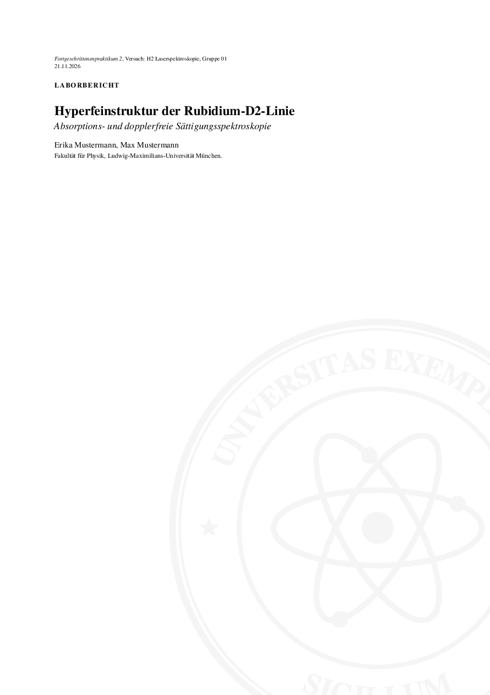
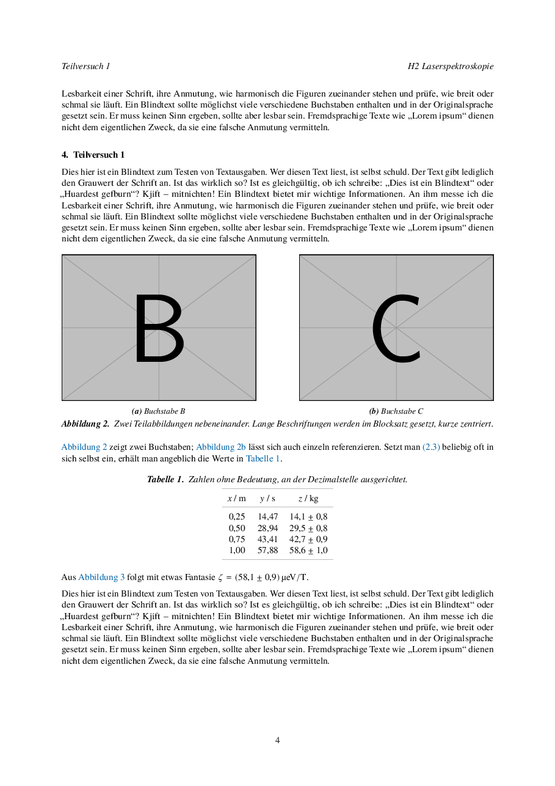

# Report Template

LaTeX template for reports. Layout based on Cambridge University Press's CUP-JNL-DTM.cls (LPPL 1.3c).

  
  

## Features

- Clean journal-style layout: TeX Gyre Termes, block paragraphs, running head with section and short title
- Title page with info line, logo, letter-spaced document type, title, subtitle, up to three authors and numbered affiliations
- Optional separate title page and a faint emblem watermark (e.g. your university's seal)
- One file per section, abstract included
- `siunitx` units and decimal-aligned tables, `cleveref` cross-references, `biblatex` with biber
- Code listings from files (`\codefile`) and full-page scans (e.g. a handwritten lab protocol) in the appendix
- German typesetting (hyphenation, captions, decimal comma)

## Quick start

1. **Code → Download ZIP**. The ZIP contains only the files the report needs.
2. In Overleaf: **New Project → Upload Project** and select the ZIP.
3. **Menu → Compiler → LuaLaTeX**, then compile.

**➜ Step-by-step instructions, including a complete lab-report example: [GUIDE.md](GUIDE.md)**

Locally: `latexmk -lualatex main.tex` (needs LuaLaTeX and biber, e.g. TeX Live 2023 or newer).

## License

[LaTeX Project Public License 1.3c](LICENSE). The class `generalreport.cls` is derived from Cambridge University Press's CUP-JNL-DTM.cls.
